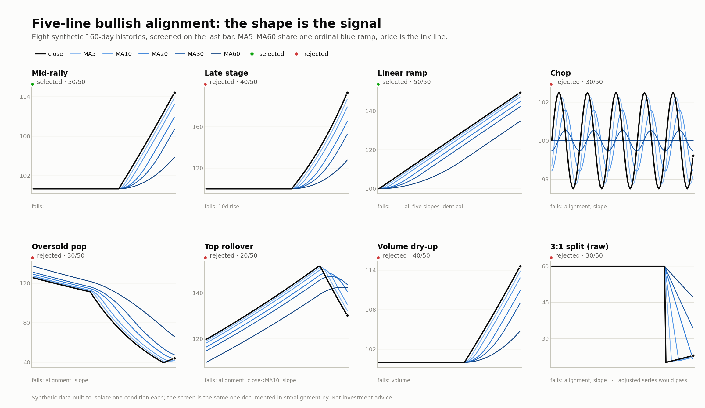

# Five-Line Bullish Alignment Screener

**A mid-rally A-share screen — and the five bugs in the version everyone copies.**

The rule is simple: MA5 > MA10 > MA20 > MA30 > MA60, every average rising, and the
10-day return still below 15%. The last clause is the whole point — it keeps you out
of the acceleration phase.

The implementation is where it gets interesting. A perfectly straight uptrend has the
same slope on all five averages, and the standard strict `>` chain **rejects it**. A
"volume expansion" test whose baseline includes today is satisfied by a +1% day. A
date-blind checkpoint makes tomorrow's run print yesterday's picks. All five defects
are preserved in [`legacy/`](legacy/), fixed in [`src/alignment.py`](src/alignment.py),
and each one has a test named after it.

Pure standard-library core, no pandas, no network, 24 tests.

[English](README.md) | [中文](README.zh-CN.md)



---

## The question it answers

> Is this stock in the **middle** of an established uptrend — structure complete,
> extension not yet extreme?

It is a cross-sectional filter, not a forecast. Output is one of: selected, or not
selected plus the conditions that failed.

### The five conditions

| # | Condition | Test | Why it is there |
|---|---|---|---|
| 1 | Alignment | `MA5 > MA10 > MA20 > MA30 > MA60` | every holding period's cost is rising |
| 2 | Above the mid-line | `close >= MA10` | price has not broken the 10-day average |
| 3 | Rising, short-first | all slopes > 0, `slope5 >= slope10 >= … >= slope60` | trend is up and driven by the short end |
| 4 | Not extended | `close / close[-11] - 1 < 15%` | do not buy the last leg |
| 5 | Volume expansion | `volume > 1.5 × prior-5 mean` and `> 1.5 × prior-10 mean` | participation is increasing |

Conditions 1–3 are the gate. Conditions 4–5 are what make it "mid-rally" rather than
"whatever went up". The score (10 per condition, max 50) **ranks inside the pass
set**; it never decides membership on its own.

---

## Quick start

```bash
pip install -r requirements.txt

# Offline: eight synthetic 160-day histories, no baostock, no network
python examples/demo_mid_rally.py

# Tests (standard library only)
python tests/test_alignment.py
python tests/test_cache.py
```

Live, against baostock (free, no registration):

```bash
# 1. build the pool (~5,000 codes)
python -m src.baostock_source build-pool --out stock_pool.csv

# 2. screen one trading day; cache and output are date-scoped
python -m src.baostock_source screen --pool stock_pool.csv --date 2026-11-10
```

As a library:

```python
from src.alignment import Bar, Config, evaluate, select

verdict = evaluate(bars, Config(), code="sh.600000")

verdict.selected          # every condition true
verdict.score             # 0..50, for ranking within the pass set
verdict.failed            # e.g. ["not_extended", "volume_expansion"]
verdict.rise              # the 10-day return that drove condition 4
```

The core is pure: `evaluate()` never touches pandas, the network, or global state,
which is why the whole rule set is reproducible from a hand-built price series.

---

## What the screen accepts and rejects

From the offline demo, all on the same synthetic last day:

| Series | Score | Here | v1 notebook | Why |
|---|---:|---|---|---|
| Mid-rally | 50 | selected | selected | textbook: base, trend, volume |
| Late stage | 40 | rejected | rejected | 10-day return 18.4% > cap |
| **Linear ramp** | **50** | **selected** | **rejected** | **all five slopes identical** |
| Chop | 30 | rejected | rejected | no alignment, no slope |
| Oversold pop | 30 | rejected | rejected | bounce, but MA60 still above |
| Top rollover | 20 | rejected | rejected | short averages rolled over |
| Volume dry-up | 40 | rejected | rejected | shape perfect, no volume |
| 3:1 split, raw bars | 30 | rejected | rejected | MA60 broken by the ex-date |
| 3:1 split, adjusted | 50 | selected | selected | same history, forward-adjusted |

The `Chop` and `Top rollover` rows are the argument against a "score > 0" watchlist:
they score 30 and 20 while no moving average is rising.

---

## Bugs this repo fixes

The project grew out of a working notebook; three successive versions are preserved
verbatim in [`legacy/`](legacy/). Reading them against hand-built series turned up
defects that all fail quietly.

| # | Defect | Effect | Fix |
|---|---|---|---|
| 1 | Strict `slope5 > slope10 > …` | A linear trend has equal slopes and is rejected; with decimal prices, float noise decides the outcome | Accept equal slopes within a price-scaled tolerance |
| 2 | Volume baseline includes today | `v > (v + sum(prev4)) / 5` collapses to `v > mean(prev4)` — a +1% day "expands" | Baseline is the prior N days; ratio defaults to 1.5× |
| 3 | `adjustflag="3"` (unadjusted) | MA60 and the 10-day return cross ex-dividend/split dates; a clean trend looks broken | Forward-adjusted prices (`adjustflag="2"`) |
| 4 | Fixed `checkpoint.csv`, no date in the key | Next day's run fetches nothing, prints yesterday's list under today's filename | Date-scoped cache files + row-level date check |
| 5 | Scoring replaces the AND | A sideways stock scores 30/50 and enters the list | `select()` requires all five; the score only ranks |

Also fixed: duplicate input codes produced duplicate rows, a suspended stock could
report last week's close as today's, and a zero-volume day in the volume baseline made
any day look like an expansion.

Each fix has a regression test named after it, e.g.
`test_linear_ramp_is_selected_here`, `test_volume_baseline_excludes_today`,
`test_previous_day_rows_are_not_reused`, `test_scoring_alone_admits_a_bearish_stock`.

---

## Repository layout

```
.
├── src/
│   ├── alignment.py          # bars → checks → score (pure, stdlib)
│   ├── cache.py              # date-scoped checkpoint + code normalisation
│   └── baostock_source.py    # retrying adapter, CLI (network)
├── examples/
│   ├── demo_mid_rally.py
│   └── figures/mid_rally_demo.png
├── legacy/                   # three original notebook versions, unmodified
├── notebooks/追涨中段因子.ipynb
├── docs/算法总结.md           # full derivation, parameter table, pitfalls (Chinese)
├── docs/公众号文章.md         # long-form write-up (Chinese)
├── tests/
└── requirements.txt
```

---

## Honest limitations

- **No backtest, no parameter validation.** Thresholds come from trading practice,
  not fitting. Nothing here is investment advice.
- **Forward adjustment moves with the query date.** Self-consistent within a day;
  a backtest must rebase history.
- **Volume is not adjusted.** Share counts jump at splits, so volume ratios are
  distorted around ex-dates.
- **No liquidity floor.** A stock trading CNY 1M a day is treated like one trading
  CNY 1B. This is the first thing to add.
- **No sector cap.** A sector-wide move produces a dozen highly correlated names.
- **Survivorship bias.** The pool is today's listed codes; delisted names are absent.
- **No exit rule.** This is a filter, not a strategy.

Full discussion in [docs/算法总结.md](docs/算法总结.md) (Chinese), sections 9–10.

---

## Data & disclaimer

Market data from [baostock](http://baostock.com). For research and education only —
**not investment advice**.

## License

MIT
