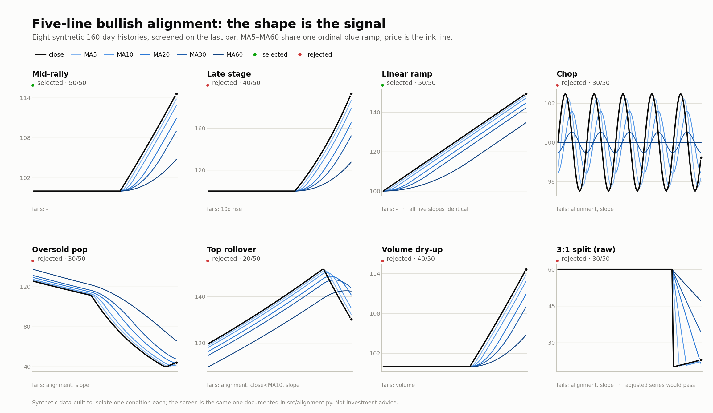

# 五线多头排列选股

**一个「追涨中段」因子，以及流行写法里的五个隐藏 bug。**

规则很简单：MA5 > MA10 > MA20 > MA30 > MA60，五条均线全部向上，
且 10 日涨幅小于 15%。最后一条是这个因子的灵魂——它负责把你挡在加速段之外。

问题出在实现上。一条**完美的直线上涨**，五条均线的斜率完全相同，
而流行的严格 `>` 斜率链会把它判为不合格。一个把当日算进基线的「放量」条件，
每天只要比前四天均值高 1% 就能通过。一个不区分日期的断点缓存，
让第二天的程序一只股票都不请求，直接把昨天的结果换个文件名打印出来。

五个缺陷都原样保留在 [`legacy/`](legacy/) 里，在 [`src/alignment.py`](src/alignment.py)
中修复，每一个都有以它命名的回归测试。核心只用标准库，不依赖 pandas 和网络，24 个测试。

[English](README.md) | [中文](README.zh-CN.md)



---

## 它回答什么问题

> 这只股票是否处在**已经确立、但还没有走完**的上升趋势中段？

它是一个截面筛选器，不是预测器。输出只有两种：入选，或者不入选加上失败原因。

### 五个条件

| # | 条件 | 判据 | 为什么需要 |
|---|---|---|---|
| 1 | 五线多头 | `MA5 > MA10 > MA20 > MA30 > MA60` | 各周期持仓成本依次抬升 |
| 2 | 站上 MA10 | `close >= MA10` | 价格没有跌破中期均线 |
| 3 | 斜率多头 | 斜率全 > 0，且 `斜率5 >= 斜率10 >= … >= 斜率60` | 趋势向上，且由短周期驱动 |
| 4 | 涨幅未透支 | `close / close[-11] - 1 < 15%` | 不追最后一段 |
| 5 | 量能放大 | 当日量 > 前 5 日均量 × 1.5，且 > 前 10 日均量 × 1.5 | 有增量资金 |

条件 1–3 是门控，条件 4–5 是「中段」的定义。得分（每个条件 10 分，满分 50）
**只在入选集合内部排序**，不单独决定是否入选。

---

## 快速开始

```bash
pip install -r requirements.txt

# 离线：8 条合成的 160 天序列，不需要 baostock、不需要联网
python examples/demo_mid_rally.py

# 测试（只用标准库）
python tests/test_alignment.py
python tests/test_cache.py
```

接实盘（baostock 免费、免注册）：

```bash
python -m src.baostock_source build-pool --out stock_pool.csv        # 全市场股票池
python -m src.baostock_source screen --pool stock_pool.csv --date 2026-11-10
```

作为库调用：

```python
from src.alignment import Bar, Config, evaluate

verdict = evaluate(bars, Config(), code="sh.600000")

verdict.selected          # 五条全满足
verdict.score             # 0..50，用于入选集合内部排序
verdict.failed            # 例如 ["not_extended", "volume_expansion"]
verdict.rise              # 触发条件 4 的 10 日涨幅
```

核心是纯函数：`evaluate()` 不碰 pandas、不碰网络、没有全局状态，
所以整套规则可以用手写的价格序列完整复现。

---

## 演示市场：谁入选，谁被拒

同一天、同一套参数：

| 序列 | 得分 | 本实现 | v1 notebook | 原因 |
|---|---:|---|---|---|
| Mid-rally | 50 | 入选 | 入选 | 标准形态：平台、趋势、放量 |
| Late stage | 40 | 拒绝 | 拒绝 | 10 日涨幅 18.4%，超过上限 |
| **Linear ramp** | **50** | **入选** | **拒绝** | **五条斜率完全相同** |
| Chop | 30 | 拒绝 | 拒绝 | 无排列、无斜率 |
| Oversold pop | 30 | 拒绝 | 拒绝 | 有反弹，但 MA60 仍在上面 |
| Top rollover | 20 | 拒绝 | 拒绝 | 短均线已经拐头 |
| Volume dry-up | 40 | 拒绝 | 拒绝 | 形态完美，但没有量 |
| 3:1 拆分（不复权） | 30 | 拒绝 | 拒绝 | MA60 被除权日打断 |
| 3:1 拆分（前复权） | 50 | 入选 | 入选 | 同一段历史，复权后是干净趋势 |

`Chop` 和 `Top rollover` 两行，就是「得分 > 0 就出票」不可用的证明：
它们能拿 30 分和 20 分，而五条均线没有一条是向上的。

---

## 修掉的五个坑

项目来自一个能跑通的 notebook，三个版本原样保留在 [`legacy/`](legacy/)。
把实现和手写序列对照着读，会发现这些缺陷的共同点是**不报错**：

| # | 缺陷 | 后果 | 修复 |
|---|---|---|---|
| 1 | 斜率链用严格 `>` | 线性趋势的斜率全部相等，被判不合格；小数价格下由浮点噪声决定生死 | 允许价格尺度容差内的相等 |
| 2 | 量能基线包含当日 | `v > (v + 前4日和)/5` 等价于 `v > 前4日均值`，高 1% 就算放量 | 基线取前 N 日，倍数默认 1.5 |
| 3 | `adjustflag="3"` 不复权 | MA60 和 10 日涨幅跨过除权日，干净趋势看起来是断的 | 默认前复权（`adjustflag="2"`） |
| 4 | `checkpoint.csv` 没有日期 | 第二天不请求任何数据，把昨天结果写成今天文件名 | 缓存按日期分文件 + 行级日期校验 |
| 5 | 评分制取代合取 | 横盘股 30 分进入结果表 | `select()` 要求五条全真，得分只排序 |

另外修了：重复代码产生重复行、停牌股把上周收盘当成今天、成交量基线里的零值
让任何一天都像放量。

每个修复都有一个以它命名的回归测试，例如
`test_linear_ramp_is_selected_here`、`test_volume_baseline_excludes_today`、
`test_previous_day_rows_are_not_reused`、`test_scoring_alone_admits_a_bearish_stock`。

---

## 目录结构

```
.
├── src/
│   ├── alignment.py          # 日线 → 五个布尔值 → 得分（纯函数，标准库）
│   ├── cache.py              # 按日期的断点缓存 + 代码规范化
│   └── baostock_source.py    # 带重试的适配器、命令行（联网）
├── examples/
│   ├── demo_mid_rally.py
│   └── figures/mid_rally_demo.png
├── legacy/                   # notebook 的三个版本，原样保留
├── notebooks/追涨中段因子.ipynb
├── docs/算法总结.md           # 完整推导、参数表、踩坑记录
├── docs/公众号文章.md         # 面向公众号的技术长文
├── tests/
└── requirements.txt
```

---

## 诚实的局限

- **没有回测，也没有参数验证。** 阈值来自交易经验，不是拟合。本文不构成投资建议。
- **前复权的基准随查询日移动。** 同一天内自洽，回测必须统一基准。
- **成交量没有复权。** 送转后成交股数跳变，除权日附近的量能比值会失真。
- **没有流动性门槛。** 日成交额 100 万和 10 亿的股票一视同仁，这是最该先补的一项。
- **没有行业上限。** 板块整体启动时，同一行业会一次选出十几只高度相关的股票。
- **幸存者偏差。** 股票池是当前上市的代码，退市样本不在其中。
- **没有退出规则。** 这是筛选器，不是完整策略。

完整讨论见 [docs/算法总结.md](docs/算法总结.md) 第 9–10 节。

---

## 数据与免责声明

行情数据来自 [baostock](http://baostock.com)。本项目仅用于研究与教育，**不构成任何投资建议**。

## License

MIT
