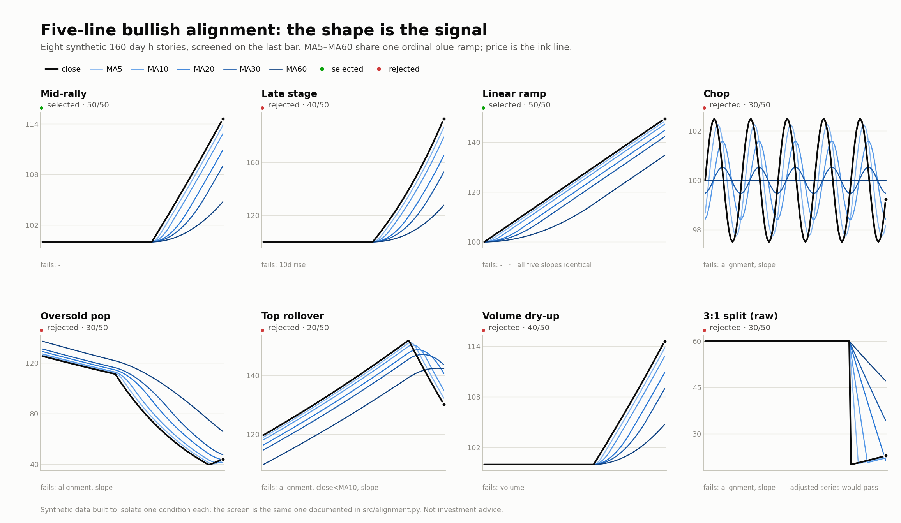

# 选股器拒绝了一条完美的上升趋势

> 五线多头排列里，五个不报错的 bug。

---

先做一个思想实验。

构造一只股票，过去 100 个交易日，每天**恰好**上涨 0.5 元。没有回撤，没有震荡，
没有一天走弱。五条均线从上到下排得整整齐齐，每天都在抬升。

这是你能画出来的、最标准的上升趋势。

把它的日线喂给一个流行的「五线多头排列」选股器，返回结果：

```
不满足条件：条件3（斜率多头）
```

它拒绝了。



---

## 一、0.5 > 0.5 为假

条件 3 的原文是：

```
五条均线斜率均 > 0，且 MA5斜率 > MA10斜率 > MA20斜率 > MA30斜率 > MA60斜率
```

代码是这么写的：

```python
slopes = [latest[f'ma{w}'] - prev[f'ma{w}'] for w in self.ma_windows]
cond3 = all(s > 0 for s in slopes) and all(
    slopes[i] > slopes[i + 1] for i in range(len(slopes) - 1)
)
```

每天涨 0.5 元，五条均线的当日变化量是多少？

```
MA5  148.50   斜率 0.5
MA10 147.25   斜率 0.5
MA20 144.75   斜率 0.5
MA30 142.25   斜率 0.5
MA60 134.75   斜率 0.5
```

`0.5 > 0.5` 是 `False`。条件 3 不成立，整只股票被淘汰。

写这行代码的人想表达的是「短周期涨得比长周期快」，也就是趋势在加速。
但严格大于号把**匀速**排除在外，而匀速恰恰是最健康的一种趋势。

更糟的是浮点。如果价格不是精确的二进制小数（大多数时候不是），
五个斜率会相差 10⁻¹⁵ 量级，`>` 的结果取决于数据的累加顺序。
同一只股票，今天入选，明天不入选，K 线一根没变。

**这不是策略问题，是边界条件问题。**

修复只需要一行：比较时允许价格尺度上的容差。

```python
eps = 1e-9 * max(1.0, abs(close))
rising = all(s > eps for s in slopes) and all(
    slopes[i] + eps >= slopes[i + 1] for i in range(len(slopes) - 1)
)
```

`>=` 取代 `>`，0.5 和 0.5 终于相等了。

那条直线，现在得 50 分（满分），入选。

---

## 二、还有四个

这个发现让我把整个 notebook 重写了一遍。原始代码有三个版本，都在仓库的 `legacy/` 里
原样保留。把每一条规则拆开、用手写的价格序列逐条验证，又挖出四个问题。

### 坑二：高 1% 就叫放量

条件 5 是「量能放大」，原代码：

```python
df['vol_ma5'] = self.MA(df['volume'], 5)
cond5 = latest['volume'] > latest['vol_ma5']
```

`vol_ma5` 是最近 5 天的均量，**包含今天**。设今天成交量为 v，前 4 天均值为 m：

```
v > (v + 4m) / 5
5v > v + 4m
4v > 4m
v > m
```

也就是说，条件 5 真正检查的是「**今天比前 4 天的均值高一点点**」。
前四天都是 100 万手，今天 101 万手，通过。10 日均量同理，等价于前 9 日均值。

一个叫「放量」的条件，实际门槛是 +0.1%。

修复：基线不含当日，倍数做成参数，默认 1.5。

```python
prior = volumes[-1 - w:-1]
base = math.fsum(prior) / w
ok = volume > config.volume_ratio * base
```

现在，「放量」终于需要真的放量。

### 坑三：不复权价格算 60 日均线

原代码：

```python
bs.query_history_k_data_plus(..., frequency="d", adjustflag="3")
```

`adjustflag="3"` 是不复权。用它算 MA60 和 10 日涨幅，会遇到送转和分红：

- 3 送 1 当天，价格除以 1.3，MA60 跨过除权日时出现断崖；
- 除息日价格下跳，10 日涨幅被压低，本该被涨幅上限挡住的股票反而通过了。

演示市场里我构造了一只 20 天前 3:1 拆分的股票。同一段历史：

| 序列 | 得分 | 结果 |
|---|---:|---|
| 不复权 | 30 | 拒绝（MA5 在 22.5 元，MA60 在 47 元） |
| 前复权 | 50 | 入选（干净的中段趋势） |

**同一只股票，同一段行情，因为取价方式不同，结论完全相反。**

修复：默认 `adjustflag="2"`（前复权），只对因子计算使用复权价。

### 坑四：第二天的程序，一只股票都不请求

这个最危险，因为它完全不报错。

原代码的断点文件名是固定的：

```python
checkpoint_file = 'checkpoint.csv'
processed_file = 'processed_codes.csv'
```

`batch_analyze` 从这两个文件恢复「已处理代码」，然后：

```python
remaining_codes = [c for c in stock_codes if c not in processed_codes]
```

第一天跑完，5000 只代码全部记录在案。

第二天用默认参数再跑：

```
开始批量分析：共 5000 只，已处理 5000 只，剩余 0 只
✅ 最终检查点已更新，共 237 只股票
✅ 最终结果已保存: output/五线多头选股_20261111_093000.csv
```

它没有请求任何行情，把**昨天**的 237 只股票读出来，按得分排了序，
写成一个以**今天**时间戳命名的新文件。日志里每一行都是「成功」。

输出文件的名字是今天的，里面的 `分析日期` 是昨天的。

修复分两层：

```python
checkpoint_path(cache_dir, date)   # checkpoint_2026-11-10.csv
processed_path(cache_dir, date)    # processed_2026-11-10.csv
reusable_rows(rows, date)          # 丢弃 分析日期 != date 的行
```

文件名带日期，行级再校验一次。即使有人手动合并了缓存，日期不匹配的行也不会被复用。

还有一个相关的细节：如果某只股票停牌，最后一根 K 线的日期不是请求日。
原代码会拿上周的收盘价，算出今天的「结论」。现在 verdict 会标记 `stale`，
日志里说明原因，而不是假装今天有数据。

### 坑五：评分制把「且」变成了「或」

notebook 的第二个版本把严格 AND 改成了评分：每个条件 10 分，满分 50，
**得分大于 0 就输出**。

看起来只是让结果更丰富，实际上改变了因子的定义。

五个条件是合取关系。条件 4（10 日涨幅 < 15%）单独满足，没有任何选股意义——
一只跌了 40% 的股票，10 日涨幅大概率小于 15%。把判定换成「满足几条」，
等于允许只满足条件 4 的股票进入结果表。

演示市场里：

| 序列 | 得分 | 为什么不该入选 |
|---|---:|---|
| Chop（横盘震荡） | 30 | 没有一条均线向上 |
| Top rollover（顶部回落） | 20 | 短均线已经拐头 |

它们都会出现在「按得分排序」的名单里。用户看到的是一个从 50 分到 20 分的列表，
很容易把 30 分当成「还可以」。

**正确的用法是：先做门控，再用得分排序。**
得分只用于入选集合内部的先后，不决定谁能进来。

---

## 三、把这些写成测试

五个坑，每一个都有以它命名的回归测试：

```
test_linear_ramp_is_selected_here
test_legacy_strict_order_rejects_the_linear_ramp
test_volume_baseline_excludes_today
test_scoring_alone_admits_a_bearish_stock
test_previous_day_rows_are_not_reused
test_a_suspended_stock_cannot_report_yesterdays_close_as_today
```

仓库里的核心是纯函数：不碰 pandas，不碰网络，没有全局状态。
一条价格序列进去，五个布尔值和一个得分出来。所以上面每一条都能在毫秒内复现，
不需要连行情、不需要等收盘。

```bash
python tests/test_alignment.py    # 15 个
python tests/test_cache.py        # 9 个
```

---

## 四、它不懂什么

写这类东西最容易犯的错，是把工具说得太神。

1. **没有回测，也没有参数验证。** 15% 的涨幅上限来自交易经验，不是拟合。
   仓库里没有收益曲线，也不构成任何投资建议。
2. **没有流动性门槛。** 日成交额 100 万和 10 亿的股票一视同仁，这是最该先补的一项。
3. **成交量没有复权。** 送转后成交股数跳变，除权日附近的量能比值会失真。
4. **没有行业约束。** 板块整体启动时，同一行业会一次选出十几只高度相关的股票。
5. **它是一个筛选器，不是策略。** 没有仓位，没有退出，没有止损。

规则系统的价值不是「更准」，是**可争论**。你可以指着某一行说
「这个斜率容差给大了」，然后去改 `rel_tolerance`，看结果怎么变。黑箱做不到这件事。

---

## 五、怎么复现

仓库：**github.com/314405571-star/ma-alignment-screener**

```bash
pip install -r requirements.txt

# 离线：8 条合成的 160 天序列，不需要联网
python examples/demo_mid_rally.py

# 测试
python tests/test_alignment.py
python tests/test_cache.py
```

接实盘（baostock 免费、免注册）：

```bash
python -m src.baostock_source build-pool --out stock_pool.csv
python -m src.baostock_source screen --pool stock_pool.csv --date 2026-11-10
```

作为库调用：

```python
from src.alignment import Bar, Config, evaluate

verdict = evaluate(bars, Config(), code="sh.600000")

verdict.selected   # 五条全满足
verdict.score      # 0..50，只在入选集合内部排序
verdict.failed     # ['not_extended', 'volume_expansion']
```

---

## 最后

那条每天涨 0.5 元的直线，其实是一个很朴素的提醒：

**规则写下来之后，它就不再是你的意图，而是代码的字面意思。**

你想说的是「趋势在加速」，代码读到的是「0.5 严格大于 0.5」。
你想说的是「今天放量」，代码算的是「今天比前四天均值高 0.1%」。
你想说的是「今天的结果」，代码读的是「昨天的文件」。

这些都不是模型能力的边界，是边界条件的边界。

而边界条件，只有在你愿意为它写一条测试的时候，才会暴露出来。

---

*代码：github.com/314405571-star/ma-alignment-screener*

*本文所有数字来自固定构造的合成行情，仅用于方法演示，不构成投资建议。*
